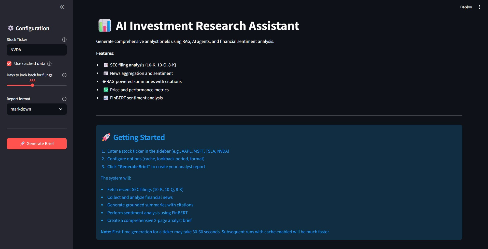
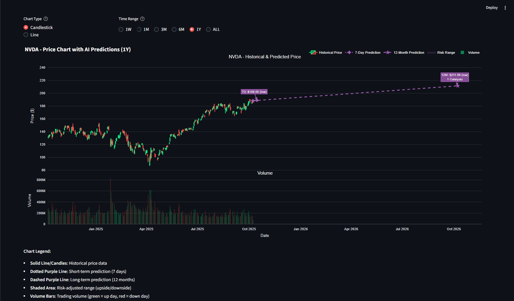

# 🤖 AI Investment Research Assistant

**Advanced RAG + Multi-Agent System + AI-Powered Financial Analysis**

An enterprise-grade intelligent system that automates investment research by combining SEC filings, financial news, and AI-driven analysis to generate comprehensive analyst briefs with actionable investment recommendations, predictive forecasts, and interactive visualizations.

## 🎯 Overview

This system revolutionizes the investment research process by:
- **Smart SEC Ingestion**: Fetches and parses SEC filings (10-K, 10-Q, 8-K) with intelligent section extraction
- **Multi-Source News Aggregation**: Combines Yahoo Finance, MarketWatch RSS, and material events
- **RAG-Powered Analysis**: Generates grounded summaries with Azure OpenAI GPT-4o-mini and verifiable citations
- **FinBERT Sentiment Analysis**: Analyzes financial sentiment with confidence intervals
- **Investment Ratings**: Multi-factor BUY/HOLD/SELL recommendations with 12-month price targets
- **Predictive Forecasting**: AI-powered short-term (7-day) and long-term (12-month) price predictions
- **Interactive Visualizations**: Dynamic candlestick charts with predictions, sentiment timelines, and performance tracking
- 📄 **Analyst Briefs**: Professional 2-3 page reports with KPIs, insights, and complete source attribution

> **Built for**: Investment analysts, portfolio managers, financial advisors, and individual investors seeking data-driven insights

## Key Features

### Advanced RAG Pipeline
- **Intelligent Document Chunking**: Section-aware chunking (800-1200 tokens with 100-token overlap)
- **Hybrid Retrieval**: Combines BM25 keyword search with Azure OpenAI semantic embeddings (text-embedding-ada-002)
- **FAISS Vector Store**: High-performance similarity search with persistent indexing
- **Citation Tracking**: Every claim backed by verifiable source references (e.g., `[1:10-K#Business]`)
- **Grounding Quality**: ≥90% citation coverage for hallucination prevention

### Multi-Agent Architecture
- **IngestionAgent**: Fetches SEC filings, parses sections, builds vector indexes
- **SummarizerAgent**: RAG-powered summaries using **Azure OpenAI GPT-4o-mini**
- **SentimentAgent**: FinBERT zero-shot sentiment analysis with bootstrap confidence intervals
- **RatingEngine**: Multi-factor investment scoring system
- **PredictiveEngine**: AI-powered price forecasting with catalyst detection
- **ReporterAgent**: Assembles professional analyst briefs with all components
- **Orchestrator**: Coordinates the entire workflow with caching and error handling

### Investment Rating System
- **Multi-Factor Scoring**: 
  - Fundamentals (35%): P/E ratio, revenue growth, profit margins
  - Sentiment (25%): News sentiment momentum and confidence
  - Technical (20%): Price trends, volatility, moving averages
  - Risk (20%): Beta, debt-to-equity, earnings volatility
- **Actionable Ratings**: Clear BUY/HOLD/SELL recommendations (0-40 SELL, 40-60 HOLD, 60-100 BUY)
- **12-Month Price Targets**: Data-driven target prices with transparent calculations
- **Sector-Aware Benchmarking**: Adjusts P/E expectations by industry (Tech vs Utilities vs Healthcare)
- **Transparent Reasoning**: Component-level scores (0-100) with detailed justifications

### Predictive Forecasting Engine
- **Dual-Horizon Predictions**:
  - **Short-term (7 days)**: News-driven momentum with high confidence (70-85%)
  - **Long-term (12 months)**: Fundamental + technical analysis with risk bands (±15%)
- **Sentiment Momentum**: Tracks velocity and acceleration of sentiment changes
- **Catalyst Detection**: Identifies earnings, partnerships, M&A, regulatory events, product launches
- **Volatility-Adjusted**: Conservative predictions with market regime awareness (bull/bear/sideways)
- **Risk Ranges**: Upside/downside targets with uncertainty quantification
- **Confidence Scoring**: HIGH (>70%), MEDIUM (50-70%), LOW (30-50%) with transparent methodology

### 📊 Interactive Visualizations
- **Unified Price Chart**:
  - Candlestick or line chart toggle
  - Historical OHLC data with 1Y lookback
  - 7-day prediction (dotted purple line)
  - 12-month prediction (dashed purple line)
  - Risk-adjusted ranges (shaded confidence bands)
  - Volume bars subplot
  - Time range selectors: 1W, 1M, 3M, 6M, 1Y, ALL
- **Interactive Controls**: 
  - Chart type switcher (Candlestick ↔ Line)
  - Timeline filtering without page refresh
- **Responsive Design**: Powered by Plotly for smooth, professional charts

### 📰 Multi-Source News Aggregation
- **Diverse Sources**: 
  - Yahoo Finance API (primary news)
  - MarketWatch RSS feeds (market commentary)
  - SEC 8-K material events (official disclosures)
- **Smart Deduplication**: Filters duplicate headlines across sources
- **Sentiment Diversity**: Improved distribution beyond neutral baseline
- **8-K Event Integration**: Material events included as high-priority "news"

### 📋 8-K Material Event Parsing
- **25 Item Types**: Comprehensive parsing of all standard 8-K items (1.01 to 9.01)
- **Event Categories**:
  - Material agreements, completed acquisitions
  - Asset dispositions, bankruptcy events
  - Director/executive changes, amendments
  - Earnings releases, financial guidance
  - Delisting notices, regulation FD disclosures
- **Smart Summarization**: Human-readable event descriptions (e.g., "Leadership Change: New CEO appointed")
- **RAG Integration**: 8-K content indexed for semantic search and citation generation

### 💹 FinBERT Sentiment Analysis
- **Pre-trained Model**: ProsusAI/finbert (specialized for financial text)
- **Zero-shot Classification**: No fine-tuning required, production-ready
- **Confidence Metrics**: 95% bootstrap confidence intervals for aggregated sentiment
- **Distribution Analysis**: Positive/neutral/negative breakdown with visualizations

## 🖼️ Screenshots

### Main Dashboard


### Interactive Price Chart with AI Predictions


### Generated Analyst Brief


### Forward Outlook & Predictions


---

## 🏗️ System Architecture

```
┌──────────────────────────────────────────────────────────────────────┐
│                   Streamlit Web UI + Plotly Charts                   │
│  (Configuration Panel, Tabs: Report/Charts/Metrics/Sentiment/Sources)│
└────────────────────────────┬─────────────────────────────────────────┘
                             │
┌────────────────────────────▼────────────────────────────────────────┐
│                         Orchestrator                                │
│            (Workflow Coordination + Caching + Error Handling)       │
└──┬───────┬──────────┬──────────────┬──────────┬──────────┬──────────┘
   │       │          │              │          │          │
┌──▼───┐ ┌─▼────┐ ┌───▼─────┐ ┌──────▼─────┐ ┌──▼─────┐  ┌──▼──────┐
│Ingest│ │Summa-│ │Sentiment│ │   Rating   │ │Predict │  │Reporter │
│Agent │ │rizer │ │ Agent   │ │   Engine   │ │Engine  │  │ Agent   │
│      │ │Agent │ │(FinBERT)│ │  (Multi-   │ │(AI     │  │(Assembly│
│      │ │(RAG) │ │         │ │  Factor)   │ │Forecast│  │ & Export│
└──┬───┘ └─┬────┘ └───┬─────┘ └──────┬─────┘ └──┬─────┘  └──┬──────┘
   │       │          │              │          │           │
┌──▼───────▼──────────▼──────────────▼──────────▼───────────▼────────┐
│                        Core Services Layer                         │
├────────────────┬─────────────────┬─────────────────┬───────────────┤
│  SEC Client    │  News Client    │  RAG Pipeline   │Azure OpenAI   │
│  (EDGAR API)   │  (Yahoo/RSS/8K) │ (Chunking+      │(GPT-4o-mini + │
│  10-K,10-Q,8-K │  Multi-source   │  FAISS+Hybrid)  │text-embed-002)│
├────────────────┼─────────────────┼─────────────────┼───────────────┤
│  Price Client  │  8-K Parser     │  FinBERT        │Visualization  │
│  (yfinance)    │  (25 Item Types)│  (Sentiment)    │Engine(Plotly) │
│  OHLCV data    │  Event Extract  │  Zero-shot      │Charts+Controls│
└────────────────┴─────────────────┴─────────────────┴───────────────┘
```

### Data Flow
1. **Input**: User enters ticker (e.g., NVDA) → Streamlit UI
2. **Ingestion**: SEC Client fetches 10-K/10-Q/8-K → Parse sections → Chunk → Embed (Azure) → FAISS index
3. **Analysis**: 
   - SummarizerAgent: Hybrid retrieval → Azure GPT-4o-mini → Generated summaries with citations
   - SentimentAgent: News aggregation → FinBERT → Sentiment scores + confidence
   - RatingEngine: Fundamentals + Sentiment + Technical + Risk → BUY/HOLD/SELL rating
   - PredictiveEngine: Momentum + Catalysts + Volatility → 7D & 12M price predictions
4. **Visualization**: FinancialCharts class → Plotly charts → Historical + Predicted data
5. **Output**: ReporterAgent assembles → Markdown/PDF report → Display in UI

## 📦 Installation

### Prerequisites
- **Python 3.12+** (recommended: 3.12.0)
- **Azure OpenAI Account** with API access
- **Git** (for cloning repository)

### Step 1: Clone Repository

```bash
git clone https://github.com/yahyasultanch/FinanceAnalyst.git
cd FinanceAnalyst
```

### Step 2: Create Virtual Environment

```bash
# Create virtual environment
python -m venv venv

# Activate environment
# Windows (PowerShell)
venv\Scripts\activate

# Windows (Command Prompt)
venv\Scripts\activate.bat

# macOS/Linux
source venv/bin/activate
```

### Step 3: Install Dependencies

```bash
# Upgrade pip
python -m pip install --upgrade pip

# Install all required packages
pip install -r requirements.txt
```

**Key Dependencies**:
- `streamlit==1.28.0` - Web UI framework
- `plotly==5.24.0` - Interactive charts
- `openai==1.54.5` - Azure OpenAI SDK
- `transformers==4.46.3` - FinBERT models
- `faiss-cpu==1.9.0` - Vector search
- `yfinance==0.2.49` - Financial data
- `pandas`, `numpy`, `beautifulsoup4`, `feedparser`

### Step 4: Configure Credentials
Create a `.env` file in the project root:
Copy example(.env.example) file
Edit `.env` with your credentials

## 🚀 Usage

### Quick Start - Streamlit Web UI (Recommended)

```bash
# Ensure virtual environment is activated
venv\Scripts\activate  # Windows
source venv/bin/activate  # macOS/Linux

# Launch Streamlit app
python run.py

```

The app will open in your browser at `http://localhost:8501`

#### Using the Web Interface

1. **Enter Stock Ticker**: Type a symbol (e.g., `NVDA`, `AAPL`, `TSLA`)
2. **Configure Options**:
   - ✅ **Use cached data**: Skip re-downloading if data exists (faster)
   - 📅 **Days to look back**: How many days of news/filings to fetch (default: 365)
   - 📄 **Report format**: Choose markdown or PDF output
3. **Generate Brief**: Click the red "🚀 Generate Brief" button
4. **Explore Results**:
   - **📊 Report Tab**: Full analyst brief with ratings and predictions
   - **📈 Charts Tab**: Interactive price chart with AI predictions
   - **📉 Metrics Tab**: Key financial metrics and ratios
   - **💹 Sentiment Tab**: News sentiment analysis and distribution
   - **📰 Sources Tab**: All data sources with links

**Expected Output**:
- **Investment Rating**: BUY/HOLD/SELL with composite score (0-100)
- **12-Month Price Target**: $XXX.XX (based on multi-factor analysis)
- **7-Day Prediction**: $XXX.XX (±Y% confidence, dotted line on chart)
- **12-Month Prediction**: $XXX.XX (±15% risk bands, dashed line on chart)
- **Sentiment Index**: +0.XX (positive/neutral/negative breakdown)
- **Interactive Chart**: Historical + predicted prices with volume


## 📁 Project Structure

```
FinanceAnalyst/
├── app/
│   └── ui_app.py                    # Streamlit web interface with tabs and charts
├── agents/
│   ├── ingestion_agent.py           # SEC filing download and indexing
│   ├── summarizer_agent.py          # RAG-powered summaries with Azure OpenAI
│   ├── sentiment_agent.py           # FinBERT sentiment analysis
│   ├── reporter_agent.py            # Report assembly and export
│   └── orchestrator.py              # Workflow coordination and caching
├── rag/
│   ├── chunking.py                  # Section-aware document chunking
│   ├── embed.py                     # Azure OpenAI embedding model wrapper
│   ├── vector_store.py              # FAISS vector index management
│   └── retriever.py                 # Hybrid BM25 + semantic retrieval
├── utils/
│   ├── sec_client.py                # SEC EDGAR API client (10-K, 10-Q, 8-K)
│   ├── news_client.py               # News aggregation (Yahoo, RSS, 8-K events)
│   ├── prices.py                    # yfinance wrapper for price data
│   ├── predictive_model.py          # Predictive model for forecsating
│   ├── visualizations.py            # Plotly chart generation (price, predictions)
│   └── md_to_pdf.py                 # Report export to PDF
├── data/                            # Cached SEC filings (gitignored)
│   ├── AAPL/
│   │   ├── 10-K_2024.html
│   │   ├── 10-Q_2024-Q3.html
│   │   └── 8-K_*.html
│   └── NVDA/
│       └── ...
├── index/                            # FAISS vector indexes (gitignored)
│   ├── AAPL_index.faiss
│   ├── AAPL_metadata.pkl
│   └── ...
├── reports/                          # Generated analyst briefs (gitignored)
│   ├── AAPL_analyst_brief_2024-10-07.md
│   ├── AAPL_analyst_brief_2024-10-07.pdf
│   └── ...
├── config.py                         # Configuration settings and paths
├── requirements.txt                  # Python dependencies
├── pyproject.toml                    # Project metadata
├── .env.example                      # Environment variables template
├── .env                              # Your credentials (gitignored, create this!)
├── .gitignore                        # Git ignore rules
├── run.py                            # Main entry point (launches Streamlit)
└── README.md
```

### Key Files Explained

- **`app/ui_app.py`**: Streamlit web interface with 5 tabs (Report, Charts, Metrics, Sentiment, Sources), chart controls, and PDF export
- **`agents/orchestrator.py`**: Central coordinator that manages all agents, handles caching, and orchestrates the full workflow
- **`rag/retriever.py`**: Implements hybrid retrieval combining BM25 (keyword) and semantic search (Azure embeddings) for best results
- **`utils/parse_8k.py`**: Parses 25 standard 8-K item types, extracts material events, and formats them as "news" items
- **`utils/visualizations.py`**: Creates interactive Plotly charts with historical prices, AI predictions (7D & 12M), risk bands, and volume
- **`agents/rating_engine.py`**: Calculates investment ratings using 4 factors (35% fundamentals + 25% sentiment + 20% technical + 20% risk)
- **`agents/predictive_engine.py`**: Generates short-term (7D) and long-term (12M) price predictions with confidence scoring


### Models
```python
# Azure OpenAI Models
EMBEDDING_MODEL = "text-embedding-ada-002"  # Azure OpenAI embedding model
LLM_MODEL = "gpt-4o-mini"                   # Azure OpenAI chat model
# Sentiment Analysis
FINBERT_MODEL = "ProsusAI/finbert"          # Pre-trained financial sentiment model
```

### SEC Configuration
```python
# SEC EDGAR API
SEC_USER_AGENT = os.getenv("SEC_USER_AGENT", "YourName your.email@example.com")
SEC_BASE_URL = "https://data.sec.gov"
SEC_RATE_LIMIT = 10  # Requests per second (SEC enforced)
```

### Rating System Weights
```python
# Multi-Factor Investment Rating
FUNDAMENTAL_WEIGHT = 0.35           # 35% from fundamental analysis
SENTIMENT_WEIGHT = 0.25             # 25% from news sentiment
TECHNICAL_WEIGHT = 0.20             # 20% from price trends
RISK_WEIGHT = 0.20                  # 20% from risk metrics

# Rating Thresholds
BUY_THRESHOLD = 60                  # Score ≥60 → BUY
HOLD_THRESHOLD = 40                 # Score 40-60 → HOLD
                                    # Score <40 → SELL
```

### Prediction Settings
```python
# Forecast Horizons
SHORT_TERM_DAYS = 7                 # Short-term prediction window
LONG_TERM_DAYS = 365                # Long-term prediction window

# Confidence Levels
HIGH_CONFIDENCE = 0.70              # ≥70% → HIGH confidence
MEDIUM_CONFIDENCE = 0.50            # 50-70% → MEDIUM confidence
                                    # <50% → LOW confidence

# Risk Bands
LONG_TERM_UNCERTAINTY = 0.15        # ±15% for 12-month predictions
SHORT_TERM_UNCERTAINTY = 0.05       # ±5% for 7-day predictions
```


## 🔍 Data Sources & APIs

### SEC EDGAR (Official U.S. Securities and Exchange Commission)
- **Base URL**: `https://data.sec.gov/`
- **Filings Supported**: 10-K (annual), 10-Q (quarterly), 8-K (material events)
- **Access**: Free, no API key required
- **Rate Limit**: 10 requests/second (enforced via User-Agent tracking)
- **Requirement**: Must set User-Agent header: `"FirstName LastName your.email@example.com"`
- **Documentation**: [SEC EDGAR API Docs](https://www.sec.gov/edgar/sec-api-documentation)
- **Compliance**: Respect rate limits, provide valid contact information

### Azure OpenAI Service
- **Models Used**:
  - **GPT-4o-mini**: Summarization, RAG-powered analysis, report generation
  - **text-embedding-ada-002**: Document embeddings for semantic search
- **Access**: Requires Azure subscription with OpenAI service enabled
- **Rate Limits**: Based on deployment tier
- **Pricing**: Pay-per-token (check Azure pricing calculator)

### yfinance (Yahoo Finance Python Library)
- **Data Types**: 
  - Historical prices (OHLCV - Open, High, Low, Close, Volume)
  - Company information (market cap, P/E ratio, sector)
  - News headlines (recent articles)
- **Access**: Free for personal/educational use
- **Rate Limits**: No official limit, use responsibly (1-2 req/s recommended)
- **Documentation**: [yfinance GitHub](https://github.com/ranaroussi/yfinance)

### MarketWatch RSS Feeds
- **Content**: Financial news articles and market commentary
- **Access**: Free RSS feeds, no API key required
- **Feed URL**: `https://feeds.marketwatch.com/marketwatch/realtimeheadlines/`
- **Parsing**: Standard RSS/XML format via `feedparser` library

### FinBERT (Financial Sentiment Model)
- **Model**: `ProsusAI/finbert` (Hugging Face)
- **Architecture**: BERT-base fine-tuned on financial texts
- **Source**: [FinBERT on Hugging Face](https://huggingface.co/ProsusAI/finbert)
- **Training Data**: Financial news, earnings reports, analyst opinions

### FAISS (Vector Similarity Search)
- **Library**: Facebook AI Similarity Search
- **Purpose**: Efficient similarity search for embeddings
- **Source**: [FAISS GitHub](https://github.com/facebookresearch/faiss)

## ⚠️ Limitations & Disclaimers

### Important Legal Disclaimers

**🚨 NOT INVESTMENT ADVICE**: This tool is for **educational and research purposes only**. The reports, ratings, predictions, and recommendations generated by this system are NOT professional investment advice and should NOT be used as the sole basis for making investment decisions.

### Ethical Considerations

**Data Privacy**:
- All data processed is public information
- No user trading data or personal information collected
- Logs may contain company tickers analyzed

**Fair Use**:
- Respect SEC rate limits (10 req/s)
- Do not abuse news APIs with excessive requests
- Comply with yfinance terms of service
- Azure OpenAI usage subject to Microsoft terms

**Responsible AI Use**:
- Always verify critical facts from original sources
- Do not blindly trust AI-generated recommendations
- Use as one input among many in investment research
- Consult licensed financial professionals for advice


## Acknowledgments

This project leverages several outstanding open-source tools and data sources:

### Core Technologies
- **[Azure OpenAI Service](https://azure.microsoft.com/en-us/products/ai-services/openai-service)** - GPT-4o-mini for summarization and text-embedding-ada-002 for semantic search
- **[Streamlit](https://streamlit.io/)** - Beautiful web UI framework for data applications
- **[Plotly](https://plotly.com/)** - Interactive data visualizations and charts
- **[FAISS](https://github.com/facebookresearch/faiss)** - Efficient vector similarity search by Facebook AI

### Financial Data & Models
- **[SEC EDGAR](https://www.sec.gov/edgar)** - Free access to public company filings and disclosures
- **[yfinance](https://github.com/ranaroussi/yfinance)** - Comprehensive financial data library for Python
- **[FinBERT](https://huggingface.co/ProsusAI/finbert)** - Pre-trained financial sentiment analysis model
- **[Financial PhraseBank](https://huggingface.co/datasets/financial_phrasebank)** - Labeled dataset for sentiment evaluation

### Development Tools
- **[Hugging Face Transformers](https://huggingface.co/docs/transformers/)** - State-of-the-art NLP models and pipelines
- **[Pandas](https://pandas.pydata.org/)** - Data manipulation and analysis
- **[BeautifulSoup](https://www.crummy.com/software/BeautifulSoup/)** - HTML parsing for SEC filings
- **[feedparser](https://github.com/kurtmckee/feedparser)** - RSS/Atom feed parsing for financial news

### Research & Inspiration
- **FinBERT Paper**: [Araci, D. (2019). FinBERT: Financial Sentiment Analysis with Pre-trained Language Models](https://arxiv.org/abs/1908.10063)

---

**Version**: 1.0.0  
**Last Updated**: October 2025 
**Author**: Yahya Sultan Chaudhry