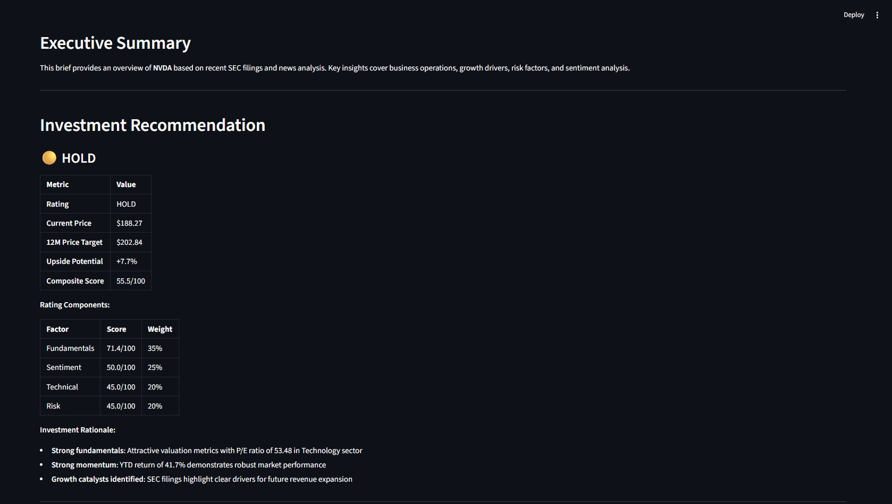
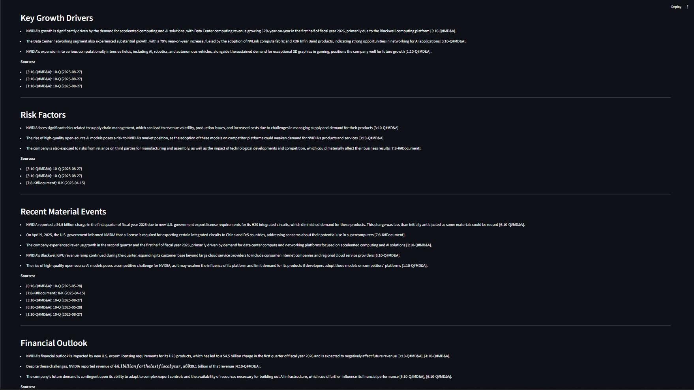
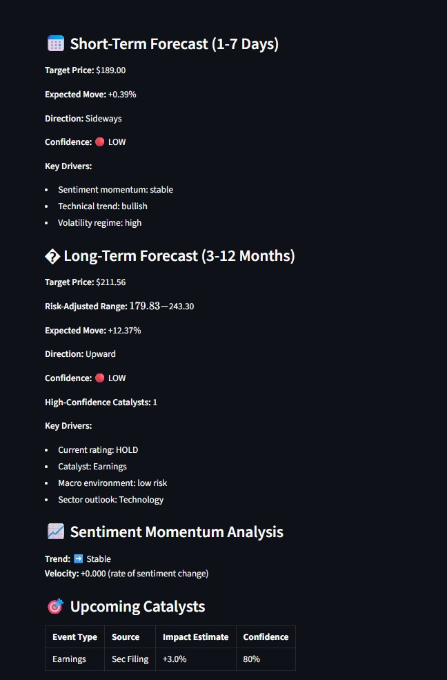
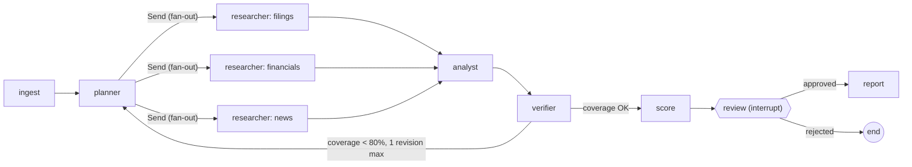

# 🤖 AI Investment Research Assistant

**Advanced RAG + Multi-Agent System + AI-Powered Financial Analysis and Prediction**

An enterprise-grade intelligent system that automates investment research by combining SEC filings, financial news, and AI-driven analysis to generate comprehensive analyst briefs with actionable investment recommendations, predictive forecasts, and interactive visualizations.

## 🎯 Overview

This system revolutionizes the investment research process by:
- **Smart SEC Ingestion**: Fetches and parses SEC filings (10-K, 10-Q, 8-K) with intelligent section extraction
- **Multi-Source News Aggregation**: Combines Yahoo Finance, MarketWatch RSS, and material events
- **RAG-Powered Analysis**: Generates grounded summaries with Azure OpenAI GPT-4o-mini and verifiable citations
- **FinBERT Sentiment Analysis**: Analyzes financial sentiment with confidence intervals
- **Investment Ratings**: Multi-factor BUY/HOLD/SELL recommendations with 12-month price targets
- **Predictive Forecasting**: AI-powered short-term (7-day) and long-term (12-month) price predictions
- **Interactive Visualizations**: Dynamic candlestick charts with predictions, sentiment timelines, and performance tracking
- **Analyst Briefs**: Professional 2-3 page reports with KPIs, insights, and complete source attribution

> **Built for**: Investment analysts, portfolio managers, financial advisors, and individual investors seeking data-driven insights

## Key Features

### Agent Orchestration (LangGraph)
- **Planner**: Splits the brief into 3-6 research tasks and assigns each to a specialist researcher, based on what is actually indexed
- **Parallel researchers**: Fanned out with LangGraph `Send`; each runs its own tool-calling loop (filings, financials or news toolset)
- **Analyst**: Synthesizes the research notes into structured claims (Pydantic-validated JSON), each citing source ids
- **Verifier**: Checks every claim; if under 80% verify, the graph loops back to the planner with targeted tasks for the failed claims
- **Human-in-the-loop**: Optional `interrupt()` pauses the graph for approve/reject before publishing; state persists in a SQLite checkpointer, so the run resumes exactly where it stopped
- **Follow-up chat**: A second graph answers questions with the same tools; conversation memory is the checkpointer thread

### Agent Memory
- **Short-term**: the SQLite checkpointer holds each brief run (resumable after review) and each chat thread
- **Long-term**: a LangGraph `Store` (SQLite), injected into nodes, keeps every published brief per ticker. The planner loads earlier briefs and registers them as a citable source; the analyst writes a verified "Changes Since Last Brief" section; the chat agent sees the ticker's history
- **Prediction ledger**: every 7-day and 12-month price call is logged (the 12-month forecast is also the rating's price target, so there is one target everywhere) with the price when it was made, then scored against actual closes once due (direction hit rate, mean absolute error). The score feeds back into the next report and the Track Record tab
- **Agent trace**: Every tool call (args, latency, sources returned, errors) and token usage is recorded and shown in the UI

### Tool Calling
- Tools are typed: Pydantic argument models become OpenAI function schemas
- The tool loop is hand-written (`agents/llm.py`) to keep the protocol visible: parallel `tool_calls` run concurrently, tool errors go back to the model as observations, and a step budget forces a final answer
- Tools: `search_filings` (hybrid search with form/section filters), `get_financial_metrics` (SEC XBRL), `get_recent_events` (8-K items), `get_news`, `get_discussions` (Hacker News, plus Reddit when configured), `get_price_summary`
- Empty results say what *is* indexed, so the agent can retry with filters that exist
- Community discussion is tagged as the *social* tier: the analyst may report what people are discussing, never use it as evidence for a fact

### MCP Server
`mcp_server.py` serves the same research tools over the Model Context Protocol (stdio), so Claude Desktop, Claude Code or any MCP client can use them. Every research tool takes a `ticker` argument, and two more run the full pipeline: `generate_brief` (the whole verified-brief graph) and `get_track_record` (remembered briefs and how their forecasts scored). The tools' Pydantic schemas become the MCP input schemas, so the agents and MCP clients share one definition. Models load on the first call, logs go to stderr (stdout carries the protocol), and tool errors come back as error results the client model can react to.

```json
{
  "mcpServers": {
    "finance-analyst": {
      "command": "C:/path/to/FinanceAnalyst/venv/Scripts/python.exe",
      "args": ["C:/path/to/FinanceAnalyst/mcp_server.py"]
    }
  }
}
```

### Observability (LangSmith)
Set `LANGSMITH_TRACING=true` and `LANGSMITH_API_KEY` to trace every run: LangGraph traces each node, and the wrapped OpenAI client plus `@traceable` spans add every LLM call (prompt, tokens) and tool call under the node that made it. Parallel tool calls run in a copied `contextvars` context so their spans nest correctly. Runs are named by thread and tagged `brief` or `chat`. With tracing off, the spans do nothing, and the in-app Agent Trace tab still shows tool calls and token usage.

### Advanced RAG Pipeline
- **Section-aware chunking**: 10-K/10-Q sections found from their real headers (skipping table-of-contents entries and cross-references); ~1000-character chunks with 100-character overlap
- **8-K exhibits**: EX-99.x press releases and CFO commentary are indexed, not just the 8-K cover page
- **Contextual chunk headers**: each chunk is embedded and BM25-indexed with a header like `NVDA 10-K (filed 2026-02-25) · Risk Factors`, so queries can match company, form, period and section
- **Safe-harbor filtering**: forward-looking-statement disclaimers ("...are forward-looking statements within the meaning of Section 27A...") are dropped at chunking. They list topics like growth and demand without saying anything, yet match outlook queries well, so they used to push real guidance out of the results. A chunk is dropped when it has 2 or more distinct disclaimer phrases, so guidance sentences that only mention "expected" stay
- **Hybrid retrieval**: BM25 + Azure OpenAI embeddings fused with weighted Reciprocal Rank Fusion, with metadata filters (form type, section)
- **Optional cross-encoder reranker** (`RERANKER_MODEL`): rescores the fused candidates locally. Off by default, because the evaluation below showed it doesn't help on this corpus
- **FAISS vector store**: Versioned, persisted indexes (currently v4), rebuilt automatically when older than 7 days or when the index version changes

### Evaluation
`python eval/run_eval.py NVDA AAPL [--briefs]` runs a retrieval ablation over 12 generic analyst questions with silver relevance labels (expected form/section + keyword pattern), and optionally full briefs. Latest run on the v4 index ([eval/results.md](eval/results.md)), 24 question-ticker pairs:

| Setup | hit@5 | MRR@10 | P@5 |
|-------|-------|--------|-----|
| BM25 only | 0.92 | 0.81 | 0.65 |
| Semantic only | 0.92 | 0.92 | 0.83 |
| Hybrid (RRF) | 0.92 | 0.90 | 0.82 |
| **Hybrid + contextual headers** (default) | **0.96** | **0.94** | **0.89** |
| + reranker, ms-marco-MiniLM-L-6-v2 | 0.96 | 0.90 | 0.82 |

Takeaways: contextual headers give the best ranking (+0.07 P@5 and +0.04 MRR over plain hybrid). The cross-encoder undoes that gain on SEC text; `bge-reranker-base`, measured on the v3 index, didn't help either (MRR 0.89), so reranking stays opt-in. Plain hybrid trails semantic-only slightly because BM25 is weak on these natural-language questions; the headers are what make the fusion pay off. The question set is small and hit@5 is near its ceiling, so treat differences under ~0.03 as noise.

End-to-end briefs (same run):

| Ticker | Claims | Verified | Revisions | LLM calls | Tokens | Seconds |
|--------|--------|----------|-----------|-----------|--------|---------|
| NVDA | 15 | 14 (93%) | 0 | 16 | 26,973 | 32 |
| AAPL | 19 | 17 (89%) | 0 | 16 | 30,578 | 27 |

Both drafts cleared the 80% threshold on the first pass, so the revision loop didn't trigger (the graph tests cover it). Each brief costs under a cent on gpt-4o-mini.

### Sources and Citations
- **Source registry**: Every tool result becomes sources with content-hash ids (`[S3f9a2c]`), so parallel agents never collide
- **Claim verification**: Each claim must (1) cite ids that exist, (2) contain only figures that appear in its sources (unit-aware: "$46.7 billion" matches "46,743,000,000"), and (3) pass an LLM-judge support check
- **Measured coverage**: The report states how many claims verified and lists the removed ones with reasons
- **Deep links and trust tiers**: Filing citations link to the quoted passage (`#:~:text=`); sources are tiered SEC > market data > news > social

### Scoring Models
- **SentimentAgent**: FinBERT sentiment with bootstrap confidence intervals
- **RatingEngine**: Multi-factor heuristic scoring
- **PredictiveEngine**: Heuristic price scenarios with keyword catalyst detection

### Investment Rating System
- **Multi-Factor Scoring**: 
  - Fundamentals (35%): P/E ratio, revenue growth, profit margins
  - Sentiment (25%): News sentiment momentum and confidence
  - Technical (20%): Price trends, volatility, moving averages
  - Risk (20%): Beta, debt-to-equity, earnings volatility
- **Actionable Ratings**: Clear BUY/HOLD/SELL recommendations (0-40 SELL, 40-60 HOLD, 60-100 BUY)
- **12-Month Price Targets**: Data-driven target prices with transparent calculations
- **Sector-Aware Benchmarking**: Adjusts P/E expectations by industry (Tech vs Utilities vs Healthcare)
- **Transparent Reasoning**: Component-level scores (0-100) with detailed justifications

### Predictive Forecasting Engine
- **Dual-Horizon Predictions**:
  - **Short-term (7 days)**: News-driven momentum with high confidence (70-85%)
  - **Long-term (12 months)**: Fundamental + technical analysis with risk bands (±15%)
- **Sentiment Momentum**: Tracks velocity and acceleration of sentiment changes
- **Catalyst Detection**: Identifies earnings, partnerships, M&A, regulatory events, product launches
- **Volatility-Adjusted**: Conservative predictions with market regime awareness (bull/bear/sideways)
- **Risk Ranges**: Upside/downside targets with uncertainty quantification
- **Confidence Scoring**: HIGH (>70%), MEDIUM (50-70%), LOW (30-50%) with transparent methodology

### Interactive Visualizations
- **Unified Price Chart**:
  - Candlestick or line chart toggle
  - Historical OHLC data with 2Y lookback
  - 7-day forecast (dotted purple line from the last close)
  - 12-month target as a dashed level, with its ±15% risk range shaded (toggle "12M target")
  - Volume bars subplot
  - Time range selectors: 1W, 1M, 3M, 6M, 1Y, 2Y
- **Interactive Controls**: 
  - Chart type switcher (Candlestick ↔ Line)
  - Timeline filtering without page refresh
- **Responsive Design**: Powered by Plotly for smooth, professional charts

### Multi-Source News Aggregation
- **Diverse Sources**: 
  - Yahoo Finance API (primary news)
  - MarketWatch RSS feeds (market commentary)
  - SEC 8-K material events (official disclosures)
  - Hacker News (keyless Algolia API, searched live by company name) and Reddit (optional, `REDDIT_CLIENT_ID`/`SECRET`) as a separate *community discussion* channel
- **Relevance filter**: a Yahoo story has to name the company or ticker; market roundups that merely tag it are dropped
- **Smart Deduplication**: Filters duplicate headlines across sources
- **Sentiment Diversity**: Improved distribution beyond neutral baseline
- **8-K Event Integration**: Material events included as high-priority "news"

### 8-K Material Event Parsing
- **25 Item Types**: Comprehensive parsing of all standard 8-K items (1.01 to 9.01)
- **Event Categories**:
  - Material agreements, completed acquisitions
  - Asset dispositions, bankruptcy events
  - Director/executive changes, amendments
  - Earnings releases, financial guidance
  - Delisting notices, regulation FD disclosures
- **Smart Summarization**: Human-readable event descriptions (e.g., "Leadership Change: New CEO appointed")
- **RAG Integration**: 8-K content indexed for semantic search and citation generation

### FinBERT Sentiment Analysis
- **Pre-trained Model**: ProsusAI/finbert (specialized for financial text)
- **Zero-shot Classification**: No fine-tuning required, production-ready
- **Confidence Metrics**: 95% bootstrap confidence intervals for aggregated sentiment
- **Distribution Analysis**: Positive/neutral/negative breakdown with visualizations

## 🖼️ Screenshots

### Main Dashboard


### Interactive Price Chart with AI Predictions


### Generated Analyst Brief



### Forward Outlook & Predictions


---

## System Architecture

### Brief graph



| Node | Does |
|------|------|
| `ingest` | Loads or builds the ticker's index; fetches news, prices and XBRL facts |
| `planner` | Loads earlier briefs from memory; LLM plan of research tasks per researcher role (re-plans from verifier feedback) |
| `researcher` | Tool-calling loop for one task; returns notes citing source ids |
| `analyst` | Structured claims per report section, citing source ids |
| `verifier` | Citation, figure and LLM-judge checks; computes coverage; routes |
| `score` | FinBERT sentiment, rating, predictions (no LLM) |
| `review` | Optional human approval via `interrupt()` |
| `report` | Scores the prediction ledger, assembles and saves the brief, writes it to memory and logs its price calls |

### Layers (original diagram)

```
┌──────────────────────────────────────────────────────────────────────┐
│                   Streamlit Web UI + Plotly Charts                   │
│  (Configuration Panel, Tabs: Report/Charts/Metrics/Sentiment/Sources)│
└────────────────────────────┬─────────────────────────────────────────┘
                             │
┌────────────────────────────▼────────────────────────────────────────┐
│                         Orchestrator                                │
│            (Workflow Coordination + Caching + Error Handling)       │
└──┬───────┬──────────┬──────────────┬──────────┬──────────┬──────────┘
   │       │          │              │          │          │
┌──▼───┐ ┌─▼────┐ ┌───▼─────┐ ┌──────▼─────┐ ┌──▼─────┐  ┌──▼──────┐
│Ingest│ │Summa-│ │Sentiment│ │   Rating   │ │Predict │  │Reporter │
│Agent │ │rizer │ │ Agent   │ │   Engine   │ │Engine  │  │ Agent   │
│      │ │Agent │ │(FinBERT)│ │  (Multi-   │ │(AI     │  │(Assembly│
│      │ │(RAG) │ │         │ │  Factor)   │ │Forecast│  │ & Export│
└──┬───┘ └─┬────┘ └───┬─────┘ └──────┬─────┘ └──┬─────┘  └──┬──────┘
   │       │          │              │          │           │
┌──▼───────▼──────────▼──────────────▼──────────▼───────────▼────────┐
│                        Core Services Layer                         │
├────────────────┬─────────────────┬─────────────────┬───────────────┤
│  SEC Client    │  News Client    │  RAG Pipeline   │Azure OpenAI   │
│  (EDGAR API)   │  (Yahoo/RSS/8K) │ (Chunking+      │(GPT-4o-mini + │
│  10-K,10-Q,8-K │  Multi-source   │  FAISS+Hybrid)  │text-embed-002)│
├────────────────┼─────────────────┼─────────────────┼───────────────┤
│  Price Client  │  8-K Parser     │  FinBERT        │Visualization  │
│  (yfinance)    │  (25 Item Types)│  (Sentiment)    │Engine(Plotly) │
│  OHLCV data    │  Event Extract  │  Zero-shot      │Charts+Controls│
└────────────────┴─────────────────┴─────────────────┴───────────────┘
```

### Data Flow
1. **Input**: User enters ticker (e.g., NVDA) → Streamlit UI
2. **Ingestion**: SEC Client fetches 10-K/10-Q/8-K (+ EX-99 exhibits) → Parse sections → Chunk → Embed (Azure) → FAISS index; XBRL company facts → key metrics
3. **Research**: Planner → parallel researchers call tools (hybrid search, XBRL metrics, events, news, prices) → notes citing source ids
4. **Synthesis and verification**: Analyst drafts claims → verifier checks every claim → re-plan if coverage is low
5. **Scoring**: FinBERT sentiment, multi-factor rating, predictions
6. **Output**: Optional human review → ReporterAgent assembles the brief with verified claims, verification summary and tiered sources → UI tabs (Report, Charts, Metrics, Sentiment, Sources, Agent Trace, Ask, Track Record)
7. **Memory**: The brief is saved to long-term memory and its price calls to the prediction ledger

## Installation

### Prerequisites
- **Python 3.12+** (recommended: 3.12.0)
- **Azure OpenAI Account** with API access
- **Git** (for cloning repository)

### Step 1: Clone Repository

```bash
git clone https://github.com/yahyasultanch/FinanceAnalyst.git
cd FinanceAnalyst
```

### Step 2: Create Virtual Environment

```bash
# Create virtual environment
python -m venv venv

# Activate environment
# Windows (PowerShell)
venv\Scripts\activate

# Windows (Command Prompt)
venv\Scripts\activate.bat

# macOS/Linux
source venv/bin/activate
```

### Step 3: Install Dependencies

```bash
# Upgrade pip
python -m pip install --upgrade pip

# Install all required packages
pip install -r requirements.txt
```

**Key Dependencies**:
- `streamlit==1.28.0` - Web UI framework
- `plotly==5.24.0` - Interactive charts
- `openai==1.54.5` - Azure OpenAI SDK
- `transformers==4.46.3` - FinBERT models
- `faiss-cpu==1.9.0` - Vector search
- `yfinance==0.2.49` - Financial data
- `pandas`, `numpy`, `beautifulsoup4`, `feedparser`

### Step 4: Configure Credentials
Create a `.env` file in the project root:
Copy example(.env.example) file
Edit `.env` with your credentials

## Usage

### Quick Start - Streamlit Web UI (Recommended)

```bash
# Ensure virtual environment is activated
venv\Scripts\activate  # Windows
source venv/bin/activate  # macOS/Linux

# Launch Streamlit app
python run.py

```

The app will open in your browser at `http://localhost:8501`

#### Using the Web Interface

1. **Enter Stock Ticker**: Type a symbol (e.g., `NVDA`, `AAPL`, `TSLA`)
2. **Configure Options**:
   - **Use cached data**: Skip re-downloading if data exists (faster)
   - **Days to look back**: How many days of news/filings to fetch (default: 365)
   - **Report format**: Choose markdown or PDF output
3. **Generate Brief**: Click the red "🚀 Generate Brief" button
4. **Explore Results**:
   - **Report Tab**: Full analyst brief with ratings and predictions
   - **Charts Tab**: Interactive price chart with AI predictions
   - **Metrics Tab**: Key financial metrics and ratios
   - **Sentiment Tab**: News sentiment analysis and distribution
   - **Sources Tab**: All data sources with links

**Expected Output**:
- **Investment Rating**: BUY/HOLD/SELL with composite score (0-100)
- **12-Month Price Target**: $XXX.XX (based on multi-factor analysis)
- **7-Day Prediction**: $XXX.XX (±Y% confidence, dotted line on chart)
- **12-Month Prediction**: $XXX.XX (±15% risk bands, dashed line on chart)
- **Sentiment Index**: +0.XX (positive/neutral/negative breakdown)
- **Interactive Chart**: Historical + predicted prices with volume


## 📁 Project Structure

```
FinanceAnalyst/
├── app/
│   └── ui_app.py                    # Streamlit web interface with tabs and charts
├── agents/
│   ├── graph.py                     # LangGraph brief + chat graphs (nodes, routing, state)
│   ├── llm.py                       # Azure OpenAI client, structured output, tool-calling loop
│   ├── tools.py                     # Typed research tools and researcher roles
│   ├── citations.py                 # Source registry and claim verification
│   ├── orchestrator.py              # Owns models/data/tools, runs the graphs, checkpointer
│   ├── ingestion_agent.py           # SEC filing download and indexing
│   ├── sentiment_agent.py           # FinBERT sentiment analysis
│   ├── memory.py                    # Long-term memory and prediction ledger (LangGraph Store)
│   └── reporter_agent.py            # Report assembly and export
├── rag/
│   ├── chunking.py                  # Section-aware document chunking
│   ├── embed.py                     # Azure OpenAI embedding model wrapper
│   ├── vector_store.py              # FAISS vector index management
│   ├── retriever.py                 # Hybrid BM25 + semantic retrieval, RRF, filters
│   └── reranker.py                  # Optional cross-encoder reranker
├── utils/
│   ├── sec_client.py                # SEC EDGAR API client (10-K, 10-Q, 8-K, exhibits, XBRL)
│   ├── xbrl.py                      # Key financial metrics from XBRL company facts
│   ├── news_client.py               # News aggregation (Yahoo, RSS, 8-K events)
│   ├── prices.py                    # yfinance wrapper for price data
│   ├── predictive_model.py          # Predictive model for forecsating
│   ├── visualizations.py            # Plotly chart generation (price, predictions)
│   └── md_to_pdf.py                 # Report export to PDF
├── data/                            # Cached SEC filings (gitignored)
│   ├── AAPL/
│   │   ├── 10-K_2024.html
│   │   ├── 10-Q_2024-Q3.html
│   │   └── 8-K_*.html
│   └── NVDA/
│       └── ...
├── index/                            # FAISS vector indexes (gitignored)
│   ├── aapl_v4.faiss
│   ├── aapl_v4.pkl
│   └── ...
├── tests/                            # pytest: retrieval, sections, citations, memory, graph flow (no API calls)
├── eval/
│   ├── run_eval.py                   # Retrieval ablation + end-to-end brief evaluation
│   └── results.md                    # Latest results
├── reports/                          # Generated analyst briefs (gitignored)
│   ├── AAPL_analyst_brief_2024-10-07.md
│   ├── AAPL_analyst_brief_2024-10-07.pdf
│   └── ...
├── mcp_server.py                     # MCP server exposing the research tools (stdio)
├── config.py                         # Configuration settings and paths
├── requirements.txt                  # Python dependencies
├── pyproject.toml                    # Project metadata
├── .env.example                      # Environment variables template
├── .env                              # Your credentials (gitignored, create this!)
├── .gitignore                        # Git ignore rules
├── run.py                            # Main entry point (launches Streamlit)
└── README.md
```

### Key Files Explained

- **`app/ui_app.py`**: Streamlit interface with 8 tabs (Report, Charts, Metrics, Sentiment, Sources, Agent Trace, Ask, Track Record) and the human review panel
- **`agents/memory.py`**: Long-term memory of briefs and the prediction ledger (record, score, summarize)
- **`agents/graph.py`**: The LangGraph graphs: planner, parallel researchers, analyst, verifier loop, scoring, review, report; plus the chat graph
- **`agents/llm.py`**: Hand-written tool-calling loop and Pydantic-validated JSON output
- **`agents/citations.py`**: Content-hash source ids, figure matching, deep links
- **`rag/retriever.py`**: Hybrid BM25 + semantic retrieval with Reciprocal Rank Fusion and metadata filters
- **`utils/sec_client.py`**: EDGAR client, including 8-K item parsing (25 item types), exhibit download and XBRL facts
- **`utils/visualizations.py`**: Interactive Plotly charts with historical prices, predictions, risk bands and volume
- **`utils/rating_engine.py`**: Investment rating from 4 factors (35% fundamentals + 25% sentiment + 20% technical + 20% risk)
- **`utils/predictive_model.py`**: Short-term (7D) and long-term (12M) heuristic price scenarios

### Tests

```bash
python -m pytest -q
```

21 tests. The graph tests drive the full LangGraph flow (fan-out, verifier revision loop, interrupt and resume, memory carried between runs) with a stub LLM, so they need no API keys. Others cover retrieval and RRF, citation checks, the MCP tool listing, safe-harbor filtering and news relevance.


### Models
```python
# Azure OpenAI Models
EMBEDDING_MODEL = "text-embedding-ada-002"  # Azure OpenAI embedding model
LLM_MODEL = "gpt-4o-mini"                   # Azure OpenAI chat model
# Sentiment Analysis
FINBERT_MODEL = "ProsusAI/finbert"          # Pre-trained financial sentiment model
```

### SEC Configuration
```python
# SEC EDGAR API
SEC_USER_AGENT = os.getenv("SEC_USER_AGENT", "YourName your.email@example.com")
SEC_BASE_URL = "https://data.sec.gov"
SEC_RATE_LIMIT = 10  # Requests per second (SEC enforced)
```

### Rating System Weights
```python
# Multi-Factor Investment Rating
FUNDAMENTAL_WEIGHT = 0.35           # 35% from fundamental analysis
SENTIMENT_WEIGHT = 0.25             # 25% from news sentiment
TECHNICAL_WEIGHT = 0.20             # 20% from price trends
RISK_WEIGHT = 0.20                  # 20% from risk metrics

# Rating Thresholds
BUY_THRESHOLD = 60                  # Score ≥60 → BUY
HOLD_THRESHOLD = 40                 # Score 40-60 → HOLD
                                    # Score <40 → SELL
```

### Prediction Settings
```python
# Forecast Horizons
SHORT_TERM_DAYS = 7                 # Short-term prediction window
LONG_TERM_DAYS = 365                # Long-term prediction window

# Confidence Levels
HIGH_CONFIDENCE = 0.70              # ≥70% → HIGH confidence
MEDIUM_CONFIDENCE = 0.50            # 50-70% → MEDIUM confidence
                                    # <50% → LOW confidence

# Risk Bands
LONG_TERM_UNCERTAINTY = 0.15        # ±15% for 12-month predictions
SHORT_TERM_UNCERTAINTY = 0.05       # ±5% for 7-day predictions
```


## Data Sources & APIs

### SEC EDGAR (Official U.S. Securities and Exchange Commission)
- **Base URL**: `https://data.sec.gov/`
- **Filings Supported**: 10-K (annual), 10-Q (quarterly), 8-K (material events)
- **Access**: Free, no API key required
- **Rate Limit**: 10 requests/second (enforced via User-Agent tracking)
- **Requirement**: Must set User-Agent header: `"FirstName LastName your.email@example.com"`
- **Documentation**: [SEC EDGAR API Docs](https://www.sec.gov/edgar/sec-api-documentation)
- **Compliance**: Respect rate limits, provide valid contact information

### Azure OpenAI Service
- **Models Used**:
  - **GPT-4o-mini**: Summarization, RAG-powered analysis, report generation
  - **text-embedding-ada-002**: Document embeddings for semantic search
- **Access**: Requires Azure subscription with OpenAI service enabled
- **Rate Limits**: Based on deployment tier
- **Pricing**: Pay-per-token (check Azure pricing calculator)

### yfinance (Yahoo Finance Python Library)
- **Data Types**: 
  - Historical prices (OHLCV - Open, High, Low, Close, Volume)
  - Company information (market cap, P/E ratio, sector)
  - News headlines (recent articles)
- **Access**: Free for personal/educational use
- **Rate Limits**: No official limit, use responsibly (1-2 req/s recommended)
- **Documentation**: [yfinance GitHub](https://github.com/ranaroussi/yfinance)

### MarketWatch RSS Feeds
- **Content**: Financial news articles and market commentary
- **Access**: Free RSS feeds, no API key required
- **Feed URL**: `https://feeds.marketwatch.com/marketwatch/realtimeheadlines/`
- **Parsing**: Standard RSS/XML format via `feedparser` library

### FinBERT (Financial Sentiment Model)
- **Model**: `ProsusAI/finbert` (Hugging Face)
- **Architecture**: BERT-base fine-tuned on financial texts
- **Source**: [FinBERT on Hugging Face](https://huggingface.co/ProsusAI/finbert)
- **Training Data**: Financial news, earnings reports, analyst opinions

### FAISS (Vector Similarity Search)
- **Library**: Facebook AI Similarity Search
- **Purpose**: Efficient similarity search for embeddings
- **Source**: [FAISS GitHub](https://github.com/facebookresearch/faiss)

## ⚠️ Limitations & Disclaimers

**NOT INVESTMENT ADVICE**: This tool is for **educational and research purposes only**. The reports, ratings, predictions, and recommendations generated by this system are NOT professional investment advice and should NOT be used as the sole basis for making investment decisions.

### Ethical Considerations

**Data Privacy**:
- All data processed is public information
- No user trading data or personal information collected
- Logs may contain company tickers analyzed

**Fair Use**:
- Respect SEC rate limits (10 req/s)
- Do not abuse news APIs with excessive requests
- Comply with yfinance terms of service
- Azure OpenAI usage subject to Microsoft terms

**Responsible AI Use**:
- Always verify critical facts from original sources
- Do not blindly trust AI-generated recommendations
- Use as one input among many in investment research
- Consult licensed financial professionals for advice


## 🔍 Acknowledgments

This project leverages several outstanding open-source tools and data sources:

### Core Technologies
- **[Azure OpenAI Service](https://azure.microsoft.com/en-us/products/ai-services/openai-service)** - GPT-4o-mini for summarization and text-embedding-ada-002 for semantic search
- **[Streamlit](https://streamlit.io/)** - Beautiful web UI framework for data applications
- **[Plotly](https://plotly.com/)** - Interactive data visualizations and charts
- **[FAISS](https://github.com/facebookresearch/faiss)** - Efficient vector similarity search by Facebook AI

### Financial Data & Models
- **[SEC EDGAR](https://www.sec.gov/edgar)** - Free access to public company filings and disclosures
- **[yfinance](https://github.com/ranaroussi/yfinance)** - Comprehensive financial data library for Python
- **[FinBERT](https://huggingface.co/ProsusAI/finbert)** - Pre-trained financial sentiment analysis model
- **[Financial PhraseBank](https://huggingface.co/datasets/financial_phrasebank)** - Labeled dataset for sentiment evaluation

### Development Tools
- **[Hugging Face Transformers](https://huggingface.co/docs/transformers/)** - State-of-the-art NLP models and pipelines
- **[Pandas](https://pandas.pydata.org/)** - Data manipulation and analysis
- **[BeautifulSoup](https://www.crummy.com/software/BeautifulSoup/)** - HTML parsing for SEC filings
- **[feedparser](https://github.com/kurtmckee/feedparser)** - RSS/Atom feed parsing for financial news

### Research & Inspiration
- **FinBERT Paper**: [Araci, D. (2019). FinBERT: Financial Sentiment Analysis with Pre-trained Language Models](https://arxiv.org/abs/1908.10063)

---

**Version**: 1.0.0  
**Last Updated**: October 2025 
**Author**: Yahya Sultan Chaudhry